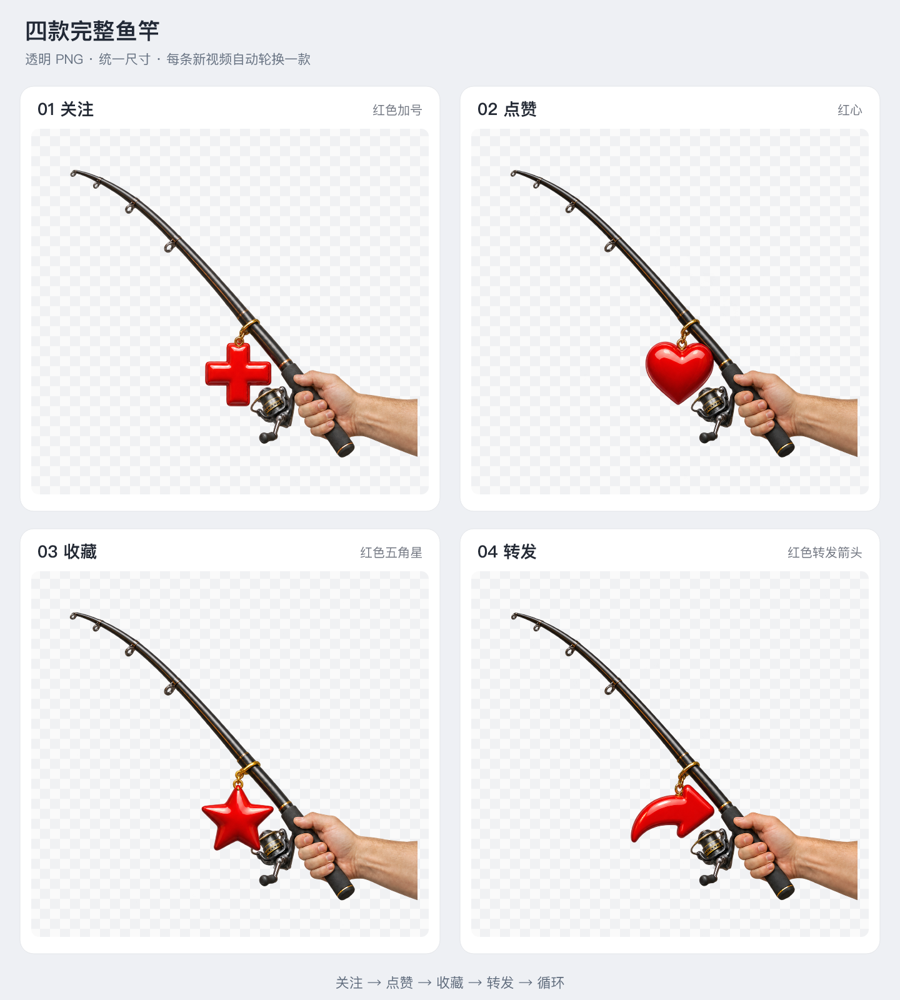

# 钓竿钓玩具

用于 Codex 的鱼竿钓走 GIF 制作技能。

内置四张完整透明鱼竿，按成功交付的视频轮换：**关注加号 → 点赞红心 → 收藏五角星 → 转发箭头**。同事安装一次后，只需把视频发给Codex，由它审片选段、抠主体、补背景、编排并验收，交付50fps GIF和60fps MP4。修改同片不换款，失败重试不跳号，各同事独立记录。

## 给同事安装

解压后把整个文件夹交给同事的Codex，说：

> 请安装这个文件夹里的 fishing-gif 技能，运行 install.py，在安装后的技能目录创建Python虚拟环境，安装 requirements.txt，并运行doctor验证。完成后用这个技能处理我上传的视频。

入口 `python install.py` 默认复制到 `$CODEX_HOME/skills/fishing-gif` 或 `~/.codex/skills/fishing-gif`，同名旧技能先备份。macOS/Windows/Linux用同一Python脚本，无需Bash。安装一次即可；当前聊天未发现新技能时，可在新聊天中使用 `$fishing-gif`。

依赖Python 3.10+、requirements.txt，以及Codex内可用的图像生成能力（补背景）。FFmpeg来自系统或依赖包。不依赖作者电脑路径、其他技能或同事填写的API Key。

`skills/fishing-gif/` 是实际技能，`tests/` 验证轮换和渲染。主体提起阶段用拾取帧原像素做连续位移摆动；选段、挂点、遮罩和背景仍由Codex按本期素材判断，不承诺严重遮挡或剧烈运镜一次完成。

发布包不含个人输入视频、状态或虚拟环境。资产生成记录在 `skills/fishing-gif/assets/rods/generation-prompts.json`。公开分发前由仓库所有者选择开源许可证。
